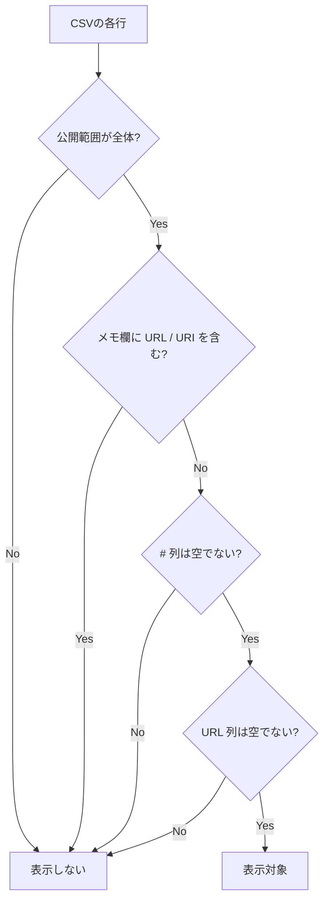

# 鐘輝かう 歌サーチ

公開URL: [https://an-oa.github.io/knksongs/](https://an-oa.github.io/knksongs/)

鐘輝かうさんの歌唱データ（公開スプレッドシート）を、曲名やアーティスト名で検索できる非公式ファンサイトです。
PC とスマホの両方に対応しています。

---

## 目次

- [使い方](#使い方)
- [主な機能](#主な機能)
- [検索の書き方](#検索の書き方)
- [表示される曲について](#表示される曲について)
- [プライバシーと保存データ](#プライバシーと保存データ)
- [免責事項・権利について](#免責事項権利について)
- [開発者向け](#開発者向け)

---

## 使い方

1. 画面上部の検索窓に曲名やアーティスト名を入力します。ひらがな・カタカナの読みでも検索できます。
2. 必要に応じて「絞り込み」ボタンからサイドバーを開き、日付範囲や動画の種類などを設定します。
3. 結果一覧と、その上の件数・条件チップが更新されます。
4. 曲名リンクから YouTube の動画を開けます。サムネイル表示を ON にすると、ページ内でも再生できます。

## 主な機能

### 検索と絞り込み

- 曲名・アーティスト名（読みを含む）で検索できます。スペース区切りで複数キーワードを指定できます（全角スペースも可）。
- 日付指定やフレーズ検索もできます。書き方は[検索の書き方](#検索の書き方)を参照してください。
- サイドバーで次の条件を絞り込めます。
  - 動画の種類: 配信 / オリ曲・歌みた / ショート / 切り抜き / 収録
  - 追加条件: 歌枠リレー / ハモリあり / コラボ(ホスト) / コラボ(ゲスト)
  - 日付範囲（From / To）
- 適用中の条件は結果一覧の上にチップで表示されます。× で個別に、「すべてクリア」でまとめて解除できます。

### おすすめ表示

- 検索条件を何も指定していないときは、よく歌われている曲をおすすめとして表示します。
  オリ曲は1回でも候補に入ります。コラボにゲストとして出演した配信の歌唱は集計しません。
- おすすめの並びは、条件を変えて戻っても維持されます。ページを再読み込みすると新しく選び直します。

### YouTube 再生

- サムネイル表示を ON にすると、サムネイルをクリックしてページ内で再生できます（× で閉じます）。
- 曲の終了時刻が登録されている場合は、その位置で再生を止めます。
  設定で「アーカイブ全体を再生」を ON にすると、止めずに再生を続けます。
- 設定で「プライバシー強化」を ON にすると、埋め込み再生に `youtube-nocookie.com` を使います。
- 再生まわりの設定は、サムネイル表示が ON のときに表示されます。
- 一部のモバイル環境では、再生開始位置が反映されない場合があります。

### ブックマーク

- ブックマークを作り、曲を追加・削除できます。名前の変更や削除もできます。
- ブックマークを選ぶと、その中で検索・絞り込みができます。
- ブックマーク表示中は、カードのドラッグハンドルで曲順を並び替えられます。並び順は保存されます。
- JSON 形式でエクスポート・インポートできます。インポートすると現在のブックマークはすべて置き換わります。
- 上限は、ブックマーク20件、1ブックマークあたり120曲、ブックマーク名64文字です。
- 元データから一時的に消えた曲も、ブックマークからは削除しません。元データに戻ると再び表示されます。

### 表示と設定

- 検索結果は最初に一定件数を表示し、末尾までスクロールすると続きを読み込みます。
- 設定パネルで、サムネイル表示とダークモードを切り替えられます。

## 検索の書き方

| 書き方 | 例 | 意味 |
| --- | --- | --- |
| スペース区切り | `夜 歌` | すべての語を含む曲（AND 検索） |
| `since:日付` | `since:2024-04` | 指定日以降（この例では2024年4月1日以降） |
| `until:日付` | `until:2024` | 指定日以前（この例では2024年12月31日以前） |
| `"…"` | `"Song until:2026"` | 囲んだ範囲を1つのフレーズとして検索 |
| `\"` / `\\` | `"say \"hi\""` | 引用符の中で `"` や `\` そのものを検索 |

- 日付は `YYYY`、`YYYY-MM`、`YYYY-MM-DD` のいずれかで書けます。年や年月だけの場合は、期間の最初または最後の日として扱います。
- サイドバーの日付範囲と併用すると、両方に当てはまる期間で検索します。
  同じ演算子を複数書いた場合は、`since` は最も新しい日、`until` は最も古い日を使います。
- `until:なんちゃら` のように日付で始まらない語は、通常のキーワードとして検索します。
  `"until:2026-13"` のように引用符で囲んだ場合も、通常のキーワードになります。
- 存在しない日付や、開始日が終了日より後になる範囲を指定すると、メッセージを表示して結果は0件になります。
- 引用符は語の区切りにもなります。`foo"bar baz"qux` は `foo`・`bar baz`・`qux` の AND 検索です。
- 全角の `＂` / `＼` も引用符・バックスラッシュとして使えます。スマート引用符（`“”`）は通常の文字として検索します。

## 表示される曲について

スプレッドシートのすべての行を表示するわけではありません。次の条件をすべて満たす行だけを表示します。

1. 公開範囲が「全体」であること。
2. メモ欄（コメント等）に `URL` / `URI` を含まないこと（非公開情報への配慮）。
3. `#` 列（行ID）が空でないこと。
4. `URL` 列が空でないこと。

URL が空の行は、以前はアーカイブがあり、現在は再生できない曲です。スプレッドシートには記録として残りますが、このサイトには表示しません。

## プライバシーと保存データ

本サイトの運営者のサーバへ個人情報を送ることはありません。独自のアクセス解析も行いません。

### 通信先

- 曲データ: GitHub Pages 上の生成済み JSON を取得します。取得できない場合だけ、Google スプレッドシートから CSV を取得します。
- YouTube: サムネイル表示や埋め込み再生では、`youtube.com` / `youtube-nocookie.com` やサムネイル配信元と通信します。

### ブラウザに保存するデータ

使い勝手のため、次の内容をブラウザのローカルストレージまたは IndexedDB に保存します。

- テーマ（ダーク / ライト）。未設定のときは OS の配色設定に従います。
- サムネイル表示、プライバシー強化、アーカイブ全体を再生の ON / OFF
- 検索状態（検索語・絞り込み条件・日付条件・選択中のブックマーク）
- ブックマーク（名前・曲と並び順・作成日時）
- 曲データのキャッシュ（IndexedDB）

ブラウザのサイトデータを削除すると、これらはリセットされます。

## 免責事項・権利について

- 本ツールはファンによる非公式プロジェクトであり、鐘輝かう様ご本人および所属団体とは関係ありません。
- 本ツール内で表示される名称・画像・動画等の権利は各権利者に帰属します。
- 権利者様からの修正・削除のご要望があれば、Issue等でご連絡ください。速やかに対応します。

## 開発者向け

- [DEVELOPMENT.md](docs/DEVELOPMENT.md): 環境準備、コマンド、テスト、ビルドの流れ
- [DESIGN.md](docs/DESIGN.md): データフロー、検索ロジック、保存形式、CI・デプロイなどの設計
- [AGENTS.md](AGENTS.md) / [WORKFLOW.md](docs/WORKFLOW.md): コーディング規約と作業の進め方
