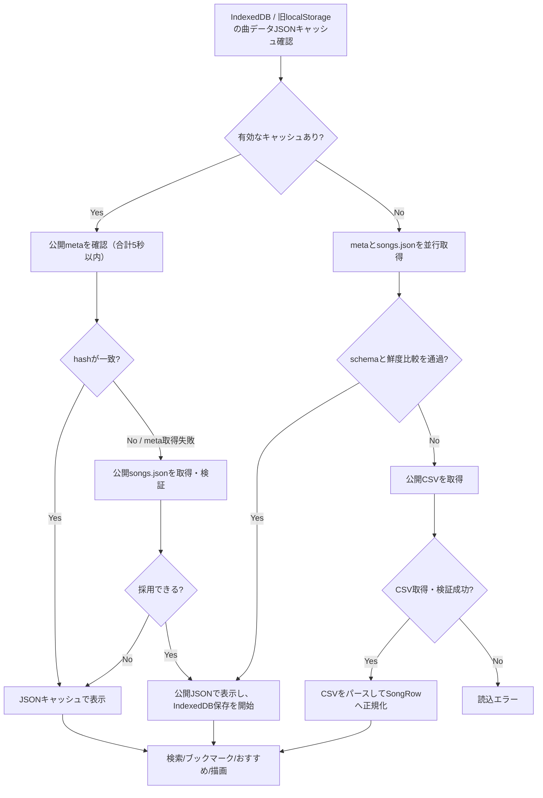
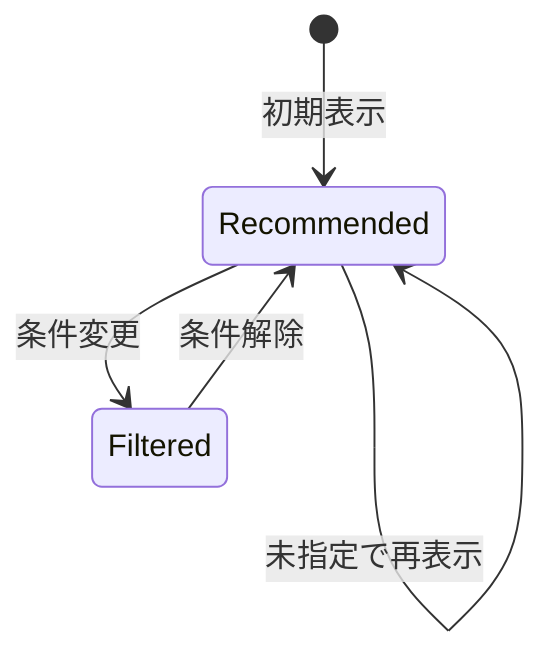
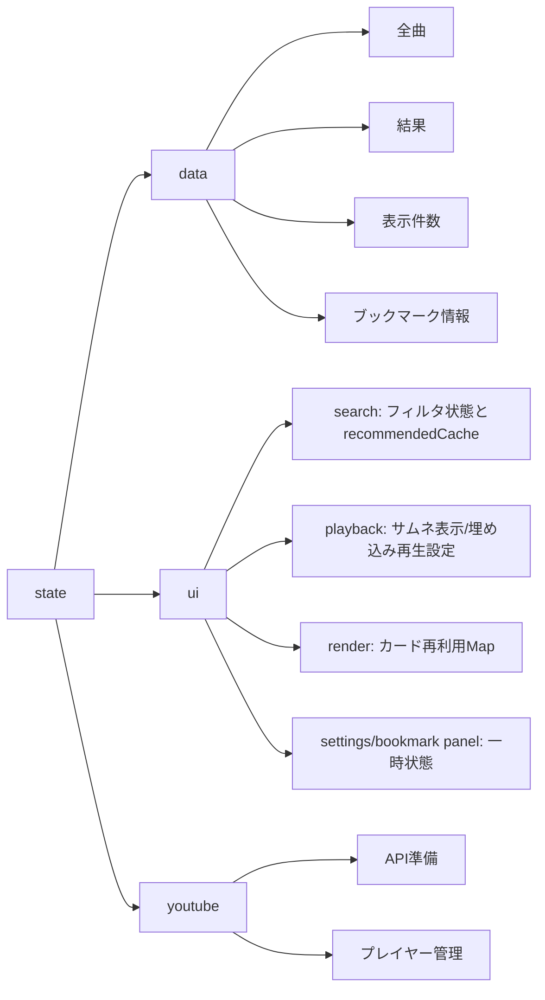

# 鐘輝かう 歌サーチ 設計書（概要）

## 目的
公開スプレッドシートの歌データを検索・絞り込みし、YouTube動画へアクセスしやすくする。

## 対象ユーザー
- 配信/歌みた/ショート/切り抜き/収録を探したい視聴者
- PC/スマホの両方から利用するユーザー

## 全体構成
- 静的フロントエンドのみ（HTML/CSS/JavaScript, ES Modules）。
  `app/**/*.mts` を source とし、`npm run build:ts` で `_build/app/**/*.mjs` へ生成した JavaScript を Node scriptsが読む。
  `.mts` 単体テストは `tsx` 経由でアプリsourceを直接読む。Node scriptsを対象とするテストはscripts経由で生成moduleも読む。型宣言の生成には依存しない。
  ブラウザ用は `npm run build` がemit結果をesbuildで `_build/browser` へbundleし、起動用UIと静的依存chunkのmodulepreloadをHTMLへ生成する。
  起動用UI以外のdynamic import先はpreload対象に含めない。
  起動moduleはデータ取得を開始してからUIをdynamic importし、同じ初期データPromiseを共有する。
- データ取得：事前生成JSON（`data/songs.json` / `data/songs-meta.json`）を優先し、唯一のマスターである公開スプレッドシートのCSVを生成元とフォールバックに使う
- データ生成/公開：GitHub Actions でCSVから派生JSONを生成・検証し、差分を `main` へコミットして CI を起動する。CI 成功後、検証済み commit を deploy 前後に現在の `main` と照合し、公開された `deployment.json` の commit SHA を確認する
- CI：GitHub Actions で TypeScript emit、曲データ検証、typecheck、lint、unit test、静的 site build を実行する。
  E2E は別の workflow で Chromium と WebKit を使って実行する
- 実行時の同梱外部ライブラリ依存：なし
- 埋め込み再生まわりでは YouTube Iframe API を動的に利用し、標準では `youtube.com`、プライバシー強化設定ON時は `youtube-nocookie.com` の埋め込みURLを使う
- 開発時確認：TypeScript emit 同期、曲データJSON検証、TypeScript noEmit typecheck、ESLint、Node.js 標準 `node:test`、Playwright（Chromium・WebKit）の smoke を利用
- 型安全性は `app/**/*.mts` の TypeScript source を中心に高め、生成 JavaScript は `_build/app`（emit）と `_build/browser`（ブラウザbundle）に置く。
  実行時に npm 等の同梱依存は持たず、配布物は HTML/CSS/JavaScript の静的 asset とする。

## テスト方針（現状）
- 対象: 検索ロジック、日付フィルタ、ブックマーク検索、描画/再生/保存/サイドバーまわりの回帰
- 重点ケース: ブックマーク表示時のみ有効なドラッグ並び替えと、並び順の永続化、YouTube 継続再生の失敗復旧
- 型検査: Node単体テスト・E2Eと共通helperはすべて `.mts` で記述する。アプリは `tsconfig.json`、Node単体テストは `tests/tsconfig.json` でstrictな型チェックを行う。
  Node scriptsは `.mts` sourceを直接参照し、scriptsと単体テストの型設定は `allowJs: false` とする。
  scripts本体は `scripts/tsconfig.json` の `noEmit: true`・`strict: true` で、共通helperを含む `scripts/**/*.mts` 全体を検査する。
  `erasableSyntaxOnly`・`verbatimModuleSyntax` でNode標準の型除去機能に対応し、Node 24.22.1でscriptsを直接実行する。
  scripts用のemitは追加せず、配布確認・通知ジョブは外部パッケージのインストールなしで動作する。
  配布失敗通知は、CLI・Issue更新手順、APIクライアント、通知状態の判定に分ける。APIクライアントは共通のページ取得ループに各応答形式の検証を渡す。
  Node直接実行のテストはscripts全体をディレクトリ構造ごとコピーし、ローカルmoduleへの分割と外部パッケージ不要の実行を両立させる。
  曲JSONの生成・検証は `#app/*` を通じ、型チェックではTSソース、実行時には生成JavaScriptを読む。
  `package.json` の `imports` に参照先を集約し、エディターも型検査と同じ `scripts/tsconfig.json` を使う。
  E2Eの型設定は `tests/e2e/tsconfig.json` に置き、`typecheck:e2e:raw` を全体のtypecheckへ組み込む。
  E2Eのfixture生成はアプリsourceを直接参照し、ブラウザでは `_site` の配布成果物を検証する。
  `typecheck` と各領域の型検査、TSソースに直接適用するlintは事前build不要で、生成物を更新しない。`test:unit` は、Node scriptsが生成moduleを読むため事前に `build:ts` を実行する。
- 責務分担:
  - Node単体テストは、ロジック・controller・DOMモックを使った状態遷移を検証する。
  - Node scriptsのテストは、生成されたアプリmoduleを読む実行経路と、曲JSON・ビルド・配布成果物の整合性を検証する。
  - E2Eは、実ブラウザでの起動順序、保存状態、レイアウト、キーボード操作、再生の連携を検証する。曲データとYouTubeの通信はfixtureへ置き換える。
  - 共通helperは、DOM・曲データ・YouTube・キャッシュなどの担当領域ごとにモックと観測処理をまとめ、テスト本文にはシナリオと期待結果を残す。

テストの配置・実行コマンド・環境準備は、[DEVELOPMENT.md](DEVELOPMENT.md)で管理する。

## 主要機能
- 検索（曲名/アーティスト名/読み/英名、複数キーワード）
- 絞り込み（形態/コラボ種別/リレー/ハモリ/日付範囲）
- ブックマーク（作成/名称変更/削除/曲の追加・削除/選択/表示中の曲順並び替え）
- おすすめ表示（条件未指定時）
- 段階表示（追加読み込み）
- サムネイル表示、埋め込み再生、再生範囲設定、プライバシー強化設定
- テーマ切替（ダーク/ライト）

## UI構成
- **ヘッダー**：ロゴ・検索・言語切替・絞り込み導線
  - ゴーグルのロゴと「鐘輝かう / 歌サーチ」の文字ロゴ（「鐘輝かう」を大きく、「歌サーチ」を小さく添える）。
    英語では「Kaneki Caw / Song Search」を同じ文字の大きさで出す。両方の言語の文字ロゴを重ねて幅を広いほう（英語）に揃え、
    切り替えても検索窓と斑点が動かないようにする
  - 検索入力（狭い画面ではロゴと絞り込みボタンの下の2段目）
  - 言語ボタン（サイトの言語を日本語と英語で切り替える。詳細は「表示言語」）
    - 日本語を読めない人にも見つけられるよう、サイドバーではなくヘッダーに置き、切り替え先の言語で
      「English」/「日本語」と表示する。ボタンの `lang` と `aria-label` も切り替え先の言語にする
    - ボタンには両方の文言を重ねて置き、幅を長いほうに揃える。押しても幅が変わらないので、検索窓と斑点の位置が動かない
    - 狭い画面では、1段目のロゴとボタンの間を斑点の余白に使うため、2段目の検索窓の右に置く
  - 「絞り込み」ボタン（サイドバーを開く）
  - ライトは白地にホルスタイン柄の斑点、ダークは赤いチェック柄。
    斑点は文字と検索窓に掛けない。ボタンは塗りつぶしてあるので、斑点がボタンの下に潜るのは許容する。
    広い画面の斑点は検索窓の両脇に置き、検索窓は斑点の場所を残して最大520pxまで広げる。検索窓を440pxより狭めないと
    斑点を置けない幅では、斑点を消して検索窓を広げる。
    狭い画面の1段目の斑点は、ロゴの文字の幅がフォントで変わるため、見出しの中に置いて、重ねた文字ロゴ（英語の幅）の右端から4px空ける
  - ヘッダー下とフッター上に、ライトはチェック柄、ダークは金色の線を引く
- **サイドバー**：絞り込み・設定
  - 条件をクリア
  - 日付選択（年/月/日セレクト、From/To）
  - 形態フィルタ（配信/オリ曲/歌みた/ショート/切り抜き/収録。UI上はオリ曲/歌みたを1項目として扱う）
  - リレー/ハモリ/コラボ種別（歌枠リレー/ハモリあり/コラボ(ホスト)/コラボ(ゲスト)）
  - ブックマーク導線（専用パネルを開く）
  - 設定導線（専用パネルを開く）
- **サイドバー内設定パネル**：表示/再生設定
  - 表示
    - サムネイル表示
    - ダークモード切替
  - 再生
    - サムネイル表示ON時のみ再生セクションを表示
    - プライバシー強化（ONでは `youtube-nocookie.com` の埋め込みURLを使用）
    - アーカイブ全体を再生（OFFでは曲データの終了秒数で停止）
    - 実験的な連続再生/リピート設定は通常UIでは非表示にし、`window.knkPlaybackSettings` からページ内だけ有効化して検証する
- **サイドバー内ブックマークパネル**：ブックマーク一覧と曲追加
  - 一覧の選択/名称変更/削除
  - 曲カードの `+` 押下時は同パネル上で既存ブックマーク選択または新規作成して追加
    - 追加に成功したら Esc と同じ終了処理でパネルとサイドバーを閉じ、`+` ボタンへフォーカスを戻す
  - JSON形式でのエクスポート/インポート。どちらもモーダルダイアログでブックマークを選ぶ
    - エクスポートは選んだブックマークだけを書き出す
    - インポートはファイル内のブックマークを手元と照合し、新規・上書き（曲の増減、並び順、名前の変化）・変更なしを示す。
      選んだものを追加・上書きする
    - 置換はインポートの取り込み方の1つとし、入口を分けない。「インポート」の ▼ で「ブックマーク全体を置換」に切り替えると、
      一覧のチェックを操作できなくし、決定ボタンを赤い「置換」に変え、削除する件数を示す。押すと削除件数つきの確認を出す
    - ダイアログ内の Esc は ▼ のメニュー、メニューが閉じていればダイアログだけを閉じ、ブックマークパネルは閉じない
- **メイン上部**：結果の概要行
  - 件数（おすすめ表示中・ブックマーク表示中を含む）
  - 適用中の条件チップ（検索語・日付・動画の種類・追加条件）。×で個別に解除する
  - すべてクリア（条件とブックマーク選択をまとめて解除する）
  - 検索語の入力エラー
- **メイン**：検索結果一覧（カード）
  - 曲名/アーティスト
  - 日付
  - タグ（形態/コラボ/リレー/ハモリ）
    - 日付・タグ・ブックマーク操作を1行に並べる。日付は折り返さず、タグが入りきらないときはタグを右寄せのまま2行目へ折り返し、
      ブックマーク操作をカードの中に残す
  - ブックマーク操作（追加/選択中ブックマークから削除）
  - ブックマーク表示中のみドラッグハンドルを表示し、ハンドル操作でカード順を並び替え
    - マウスもタッチも Pointer Events で扱い、ブラウザの Drag and Drop は使わない。
      Android の Firefox は、タッチで Drag and Drop を始められないため（Mozilla Bug 1764177）
    - ハンドルを指で押したまま動かすと、ページをスクロールせずに並べ替える。長押ししても文字の選択やメニューに変わらない
    - ドラッグ中、移動元のカードは半透明にし、ポインタの下のカードの枠へ移して、離したときに落ちる場所を示す。
      ポインタにカードの写しは付けない。写しも出すと、同じカードが二重に見えるため
    - 画面の上端（ヘッダーの下端）と下端の近くでは、ページを自動でスクロールし、画面の外の位置へも運べるようにする
    - ドラッグ中は、指したカードのホバー表示（縁取りと金色の影）を出さない。握っているカードは半透明の移動元でわかる
    - 他のカードは 1 枠ずつよけてスライドする。上から運ぶとよけるカードは上へ、下から運ぶと下へ動く。
      動きを減らす設定（`prefers-reduced-motion: reduce`）ではスライドしない
    - 結果一覧の中（カードの間の隙間を含む）で離すと、見えている順序で保存する。一覧の外で離したときや Esc で取り消したときは、元の順序へ戻す
  - YouTubeリンク
  - 0件のときはゴーグルのアイコンと、キーワードや絞り込みを見直す案内を表示

## データフロー
1. IndexedDB、なければ旧localStorageの曲データJSONを読み込み、構造を検証する。読み取り中は移行保存・削除を行わない。
2. 有効なキャッシュがあれば公開 `songs-meta.json` を確認する。
   - hash が一致すればキャッシュを初回表示に使い、JSON本体の取得を省く。
   - hash が異なる場合は、キャッシュの生成日時に関係なく公開 `songs.json` を取得する。
   - meta の取得・検証に失敗しても、共通期限内ならJSON本体の取得を試す。
3. 有効なキャッシュがある場合、metaとJSON本体の通信を合計5秒以内に制限する。
   期限切れで通信を中断し、遅れた応答は採用しない。JSON取得・検証失敗時もキャッシュへ退避する。
4. 公開JSONはschemaを検証し、metaがある場合はhash一致またはJSON本体の生成日時が新しい場合だけ採用する。
   metaより古いJSONや、同じ生成日時でhashが異なるJSONは採用しない。metaがなければJSON本体だけで検証する。
   採用したJSONは受信した文字列のままIndexedDBへ保存を開始し、完了を待たず検証済みの曲配列を初回表示に使う。
   保存失敗は表示データの採用やCSVへの退避条件に影響しない。旧キャッシュを採用した場合も非同期で移行保存し、保存成功後だけ旧localStorageを削除する。
5. 有効なキャッシュがない場合はmetaとJSON本体を並行取得する。
   JSONを採用できなかった場合だけ公開CSVを取得し、曲データへ正規化する。CSVは実行時キャッシュへ保存しない。
6. metaはresponse受信と本文読込に各2秒、JSON本体はresponse受信に2秒・本文読込に30秒、CSVは
   response受信に3秒・本文読込に30秒の段階別期限を設ける。キャッシュがある場合は共通の5秒期限と
   段階別期限の早い方で打ち切り、キャッシュがない場合は段階別期限だけを適用する。
7. 曲データを状態へ反映し、日付境界・検索UIを初期化する。表示後の自動再取得や次回検索での差し替えは行わず、
   公開側の更新はページの再読み込み時に確認する。
8. （ブックマーク選択中なら）ブックマーク内の曲集合を解決する。
9. 条件未指定ならおすすめ結果を解決し、通常時は検索条件を取得してフィルタする。
10. 結果一覧を描画し、通常検索/ブックマーク検索/おすすめで未表示の結果がある場合は段階表示を有効化する。

### マスターCSVと派生JSON
- 公開スプレッドシートのCSVを唯一のマスターデータとする。JSONを直接修正する更新経路や、
  JSONからCSVへ戻す経路は持たない
- CSVのURLは `app/config.mts` の `PUBLIC_CSV_URL` で指定する。曲JSON生成とブラウザのCSVフォールバックの両方が参照する
- CSVの `配信上の立場` は `streamRole` としてJSONへ保持する
- CSVの `Song Title` / `Artist Name` / `Artist Sort Name` は任意列とし、列がないCSVでは空文字にする。
  `Song Title` / `Artist Name` は英語表記の表示用に、シートの値をそのまま `titleEn` / `artistEn` としてJSONへ保持する。
  英訳とローマ字の混在や空白の付け方も、公式に近い情報源から入力したシートの内容に従い、変換しない。
  3列とも正規化した値を `titleEnNorm` / `artistEnNorm` / `artistSortNorm` として検索に使う。
  `Artist Sort Name` は MusicBrainz の sort name に倣い、人名を「姓, 名」、文字の代わりの記号を文字に直した値とする
- `songs.json` / `songs-meta.json` は、現在表示・再生可能な曲を配信する派生成果物とする
- 両JSONはschema Version 5として、同じ `contentHash` とUTC ISO 8601形式の `generatedAt` を持つ。
  `generatedAt` はcontentHashが変わった場合だけ更新し、同じ内容の定期生成では引き継ぐ
- 実行時は現行schemaだけを受け付け、不正・旧schemaのキャッシュは未キャッシュと同じ取得経路へ進む。公開JSON採用時は上書きし、採用失敗時だけ非同期で削除する
- 公開対象でもURLが空の行は、現在再生できない曲の履歴としてCSVへ残し、エラーにせず派生JSONから除外する。
  URLが非空で不正な場合は品質エラーとして生成を停止する
- CSVから公開対象曲へ変換した直後に、必須文字列、YouTube URL・動画ID、再生範囲、
  `archiveOrder`の整数性、曲参照キーの生成規則と一意性を全件検証する。
  問題はCSV行番号と曲名でまとめて報告し、検証成功前はどちらのJSONも書き換えない
- CSV行番号は変換中だけ曲候補と同じオブジェクトに保持し、`SongRow`や派生JSONには含めない
- 開始位置`0`と終了位置`null`は、ショート・切り抜き・歌みたなどの動画全体を再生する正常値とする。
  非空の不正な終了時刻・画面の向きに対する既存の警告とフォールバックは維持する
- ブラウザのCSVフォールバックも同じ変換・品質検証を通し、CSVは検証前後を問わず保存しない
- JSONの生成・読み込み・キャッシュ復元では、リンクがHTTPSのYouTube URLであること、
  許可ホストと動画ID形式、URLと再生用動画IDの一致を検証する
- 派生JSONの検証では、両ファイルの構文、各曲の必須フィールド・型・未知フィールドを含むスキーマ、
  曲参照キーの生成規則と一意性、
  `contentHash`と`generatedAt`同士の一致、曲配列から再計算したhashとの一致だけを確認し、
  曲データの意味的品質は再判定しない

## データモデル（概要）
`SongRow`
- date / dateKey / archiveId / archiveOrder
- videoId / songKey / bookmarkSongKey / legacySongKey / format / streamRole / videoOrientation / isRelay / isHarmony
- title / artist / titleYomi / artistYomi
- titleEn / artistEn（英語表記。シートの値をそのまま持つ）
- endSeconds
- titleNorm / artistNorm / titleYomiNorm / artistYomiNorm
- titleEnNorm / artistEnNorm / artistSortNorm（並び替え用の英名は表示しないため、正規化済みの値だけを持つ）
- url

### 曲参照キーの役割分担
- `songKey`: `archiveId::archiveOrder` を使う内部参照キー。カード再利用、描画更新、既存の画面内処理で利用する。
- `bookmarkSongKey`: `videoId::archiveOrder` を優先するブックマーク保存用キー。`videoId` を抽出できない場合は `songKey` へフォールバックする。
- キー生成、旧参照の正規化、参照インデックス構築、一意性検証は`song-identity`へ集約する。
- ブックマーク検索では `bookmarkSongKey` を優先して曲行へ解決し、旧ブックマークの `songKey` / `legacySongKey` は現行キーへ移行する。
- 旧数値参照はCSV行位置の変化で別の曲を指し得るため解決せず、実行時モデルへ持ち込まず読み込み時に除外する。

## 検索・絞り込みロジック
- 検索語：NFKC・読み・大小文字・連続空白を正規化したAND検索。曲データ側にも同じ空白正規化を適用する。
  各語は曲名・アーティスト名・読み・英名（`Song Title` / `Artist Name` / `Artist Sort Name`）のいずれかに部分一致すればよい
- 語と曲データの比較では、構文解析後の語と曲データの両方から句読点・記号・空白を除く。
  絵文字に付く異体字セレクタ・ゼロ幅接合子・囲み記号も記号の一部として除き、不可視文字だけで別の絵文字に一致させない。
  `larc` は `L’Arc〜en〜Ciel`、`hatsune miku` は `Hatsune, Miku` に一致する。記号を除くと空になる語（`★` など）は、
  記号を残した正規化済みの値と比べる。おすすめの同一曲判定は記号を残した正規化済みの値のまま行う
  空白区切りの語に加え、二重引用符で囲んだ範囲を1つの検索フレーズとして扱う
- 引用符は検索要素の境界とし、空白がなくても引用部分と非引用部分を分割する。
  `foo""bar` は `foo` と `bar`、`foo"bar baz"qux` は `foo`、`bar baz`、`qux` としてAND検索する。
  引用句の前後空白を無視して内部の連続空白を1つへ揃え、空引用句は検索条件として無視する
- 引用句内の `\"` は引用符、`\\` はバックスラッシュとして扱い、それ以外のバックスラッシュは通常文字として保持する。
  NFKCでASCIIへ変換される全角の `＂` / `＼` も構文として認識し、スマート引用符の `“”` は通常文字として扱う。
  引用符が閉じられていない場合は構文エラーとして検索結果を0件にする
- 形態：選択セットに含むか。`オリ曲` はUI上 `歌みた` と同じ項目で扱う
- コラボ種別：`コラボ(ホスト)` は `streamRole` が `ホスト`、`コラボ(ゲスト)` は
  `ゲスト` の行を対象にする。両方選択時はホスト・ゲストのいずれかに一致する行を対象にする
- リレー/ハモリ：チェック時のみ条件を追加
- 日付：From/To の範囲一致（部分入力は範囲に補正）に加え、検索ボックスの
  `since:YYYY[-MM[-DD]]` と `until:YYYY[-MM[-DD]]` を扱う。年・年月では末尾の `-` も許容し、
  `since` は年初・月初、`until` は年末・月末へ補正する。すべて包含境界とし、From/Toと
  演算子を併用した場合は下限の最大値と上限の最小値による共通部分を検索する
- 同一の日付演算子を複数指定した場合、`since` は最も新しい日、`until` は最も古い日を採用する
- `since:` / `until:` の接尾辞が空、または数字・ハイフン・スラッシュから始まる場合は
  日付演算子候補とする。形式不正または実在しない値は `invalid-date-operator` issueとして保持し、検索結果を0件にする。
  日付として始まらない接尾辞は通常キーワードとして扱う。`since` が `until` より後の場合も
  解析結果で範囲矛盾として扱い、検索結果を0件にする
- 日付演算子は完全に非引用の検索要素だけを認識する。`since:2024"foo"` は日付演算子とキーワード、
  `since:"2024"` は不正な `since:` と引用キーワード、`"since:2024"` は通常キーワードとして扱う
- 空引用句を除いた解析結果にキーワードも日付演算子もなく、他の絞り込みやブックマークもなければおすすめ表示にする。
  不正日付、範囲矛盾、未終了引用符がある場合は空検索よりエラーを優先し、検索結果を0件にする。
  保存・復元では入力文字列を変更せず、実質的な空検索かどうかは解析結果から判定する
- 不正・矛盾した日付演算子と引用符エラーは、検索のデバウンス後またはblur時に
  インラインメッセージ、`aria-invalid`、検索結果を同期する。同じメッセージは再設定せず、
  修正によって入力が有効になった場合はエラー状態を消去する
- tokenizerとparserは`search-query` moduleに集約し、無効日付、未終了引用符、範囲矛盾を
  判別可能な`issues`として一元管理する。UIはissueを日本語文言へ変換するだけとし、
  issue追加時の文言漏れをTypeScriptの網羅性検査で検出する
- 検索実行ごとに解析結果を1回だけ作り、UI検証、おすすめ判定、ブックマークを含む曲絞り込みで共有する。
  解析結果は永続化せず、入力・blurなど別イベントではその時点の入力を改めて解析する

## おすすめ表示の方針
- 条件未指定時におすすめ表示
- おすすめは条件変更でおすすめ表示を離脱して戻っても同じ並びを再利用する
- 曲データは公開側を確認して初回表示前に確定し、表示中の自動再取得・差し替えは行わない

## おすすめの状態遷移

### 状態
- **Recommended**: おすすめ表示中（条件未指定）
- **Filtered**: フィルタ/検索によりおすすめ条件から外れた状態

### 条件判定（「未指定」の定義）
- 検索語が構文上有効で、空引用句を除いたキーワードと日付演算子が空
- 日付が未指定（From/To ともに年・月・日が未選択）
- 形態フィルタ5項目がすべてON（配信 / オリ曲/歌みた / ショート / 切り抜き / 収録）
- コラボ種別/リレー/ハモリがOFF
- ブックマークが未選択

### 遷移ルール
- **Recommended → Filtered**
  - キーワード入力
  - 日付の指定（年/月/日いずれか）
  - 形態のチェックを外す
  - コラボ種別/リレー/ハモリをON
- **Filtered → Recommended**
  - 上記の条件をすべて解除して「未指定」に戻したとき

### 並びの扱い
- **Recommended 状態は同条件なら固定**
- **条件を変えて元に戻しても並びは維持**

### 表示の扱い
- Recommended では「おすすめを表示中」の状態テキストを表示
- Filtered では「n件がヒット」の状態テキストを表示
- ブックマーク選択中は「ブックマーク名 + 件数」を状態テキストに表示
- どちらの状態でも検索条件の変更は即時に反映される

- 図中の「条件変更」は、キーワード入力・日付指定・形態の絞り込み・コラボ種別/リレー/ハモリONをまとめた表記。
- 図中の「条件解除」は、上記の条件をすべて外して未指定に戻すことを指す。
- 初回データ読み込み時は、採用した曲データからおすすめキャッシュを作り直す。

## おすすめ抽出の具体ロジック

### 対象母集団
- JSONまたはCSVから読み込んだ全曲データ（`data.allSongsRaw`）
- ブックマーク未選択かつ、形態/コラボ種別/リレー/ハモリ/日付/キーワードの条件がすべて未指定のときのみ「おすすめモード」

### 除外条件
- 形態/コラボ種別/リレー/ハモリ/日付/キーワードのいずれかが未指定条件から外れた場合は、おすすめモード自体を解除
- おすすめ候補の集計対象は配信上の立場が `ゲスト` 以外の行に限定し、対象形式は `配信` / `歌みた`（`オリ曲` を含む） / `ショート` とする
- 通常は同一曲が一定回数以上歌われている場合のみ、おすすめ候補に含める
- ただし `オリ曲` を含む曲は1回でもおすすめ候補に含める
- 同一曲・同一アーカイブの重複候補は、最大の `archiveOrder` を持つ歌い直し後の行へ集約する。
  `archiveOrder` まで同じ場合はCSVで上にある行を代表とする

### シャッフルタイミング
- 初回データ読み込み時におすすめを抽出・シャッフル
- 条件を変更しておすすめから離脱→条件を元に戻す場合は、同じおすすめ並びを維持

### キャッシュの扱い
- おすすめ一覧は `ui.search.recommendedCache` に保持
- 条件変更ではキャッシュを破棄しない
- ページの再読み込み時は公開データの確認後、おすすめを新しく抽出する

## 関連関数の責務一覧（おすすめ）
- `createBrowserSongsDataSource()`：ブラウザの IndexedDB / localStorage を使う曲データ取得元を作る
- `createSongsDataSource()`：生成済みJSON、JSONキャッシュ、meta hash、CSVフォールバックをまとめ、
  公開metaを基準に初期スナップショットを選び、キャッシュがある場合の通信を合計5秒に制限する
- `createDataLoader()`：初期スナップショットの取得完了後に状態と検索UIへ反映する
- `createBookmarkPersistenceController()`：ブックマーク本体の読込・保存と、曲データ反映後の旧参照移行を扱う
- `createSearchCoordinator()`：検索の即時実行とデバウンスを管理する
- `applyLoadedSongs()`：曲データ読込後の初期化と、おすすめキャッシュのリセット
- `pickRecommendedSongsWithCache()`：おすすめ候補の抽出とシャッフル、キャッシュ利用の中心
- `scheduleSearch()`：search coordinator が検索/絞り込みの実行をデバウンスして呼び出す
- `search()`：条件取得と検索語の1回限りの解析→検証→フィルタ→表示までの入口
- `updateDisplay()`：結果のカード表示と「おすすめ/ヒット件数」表示の切替
## 状態管理
`state`
- `data`：全曲/結果/表示件数/ブックマーク情報/選択中ブックマーク
- `ui`：検索/日付/再生/描画/設定パネル/ブックマークパネルなどの画面状態
- `youtube`：API準備/プレイヤー管理

## 表示言語
- 画面の文言と、曲名・アーティスト名の表記を、日本語と英語で切り替える。言語は1つで、両方を同時に切り替える
- 初期の言語は URL の `?lang`、保存値（`siteLanguage`）の順に従い、どちらもないか不明な値のときは、ブラウザの優先言語が日本語なら日本語、
  それ以外なら英語とする。優先言語が分からなければ、HTML に書いてある日本語とする
- 言語は候補から直接決め、保存は別に試みるだけにする。保存できない環境でも、このページで選んだ言語（`?lang` や言語ボタン）は
  ページを開いている間は保ち、フォーカス復帰などで保存値と同期し直しても、古い保存値やブラウザの言語へ戻さない。
  保存できた選択は、別のタブで変えた言語に従う
- 言語を使う controller や関数は、言語を必須で受け取る。日本語への既定は起動時の判定だけに置き、内部で日本語に補わない
- 切り替えると `<html lang>` も変える。英語のページで英名のない曲名を日本語のまま出すときは、その要素に `lang="ja"` を付ける
- 文言は `app/lib/ui-text.mts` の辞書にまとめる。ブックマークの画面・通知・確認・エラーの文言は量が多いので、
  `app/ui/bookmark/text.mts` に分ける。英語では件数の単数と複数を書き分ける。英語の用語は、マスターシートの英語版のビューの表記に合わせる
  （絞り込みと条件チップでは、配信 = Singing Stream、オリ曲・歌みた = Originals & Covers、ショート = Shorts、切り抜き = Clip、
  収録 = Pre-recorded）。カードのタグは幅が狭いので短くし、1件を表す単数形にする
  （Stream、Cover、Original、Shorts、Clip、Recording）
- `index.html` の固定の文言は、要素に `data-i18n`（文字）や `data-i18n-aria-label` などの属性で辞書のキーを付け、
  起動時と切り替え時に置き換える。日本語の辞書の文言は HTML と同じにし、置き換えの前後で日本語の表示を変えない。
  キーと文言の一致は単体テストで確かめる
- ヘッダーのように、言語で幅が変わるとレイアウトが動く文言は、両方の言語の要素を重ねて `data-i18n-lang` で辞書の言語を固定し、
  CSS でページの言語の方だけを見せる
- 切り替え時は検索をやり直さず、カード、件数表示、条件チップ、形態の選択肢、日付の選択欄、検索語のエラー、
  埋め込み再生の閉じるボタン、ブックマークの一覧を今の言語で描き直す。おすすめの選曲は変わらない
- カードは文言（曲名、アーティスト名、日付、タグ、ボタンの説明）だけを書き直し、サムネイルや再生・クリックの処理は作り直さない。
  文字の長さで高さが変わるので、配置だけを計算し直す
- 件数表示は `app/ui/result-summary/count.mts` だけが書く。接続中・読み込み中・読込エラー・検索結果の件数を文言ではなく状態で持ち、
  今の言語の文言にする。読み込みと検索は状態を渡すだけにし、固定の文言の置き換えの対象にもしない。
  読み込み中に言語を切り替えても、その後のエラーや件数は切り替えた言語で出る
- 英語のカードの日付は `dateKey` から「Oct 8, 2026」の形にする。日付の選択欄の未選択は、幅に合わせて「YYYY」「MM」「DD」とする
- ページのタイトルも言語に合わせる（「鐘輝かう 歌サーチ」/「Kaneki Caw Song Search」）
- URL の `?lang=en` / `?lang=ja` は、言語ボタンで選んだときと同じく保存し、アドレス欄からは消す
- SNS は JavaScript を動かさずに OGP を読むので、閲覧者の言語では出し分けない。サイト本体（`/`）の OGP は日本語にし、
  英語で共有するための `/en/` を別に置く。`/en/` は英語の OGP（タイトル、説明文、`ogp-en.png`）だけを持つ移動用のページで、
  開いた人を埋め込みスクリプトで `../?lang=en` へ移動させる。JavaScript が動かない環境のためにリンクも置き、`noindex` で検索結果に載せない。
  英語表示のサイトのアドレス欄は `/` のままなので、英語の OGP を出したいときは `/en/` の URL を共有する
- HTML は日本語で書いてあるので、英語で開くときは `index.html` の埋め込みスクリプトが最初の描画の前に言語を判定し、
  `<html lang="en">` と `i18n-pending` クラスを付ける。このクラスがある間は中身を隠し、上部に金色の細い読み込み中のバーを出す。
  アプリが固定の文言を置き換えたら外し、JavaScript を読み込めなかった場合も4秒後には表示する。判定はアプリ側と同じ順序（`?lang`、保存値、ブラウザの言語）にし、
  保存値を読めない環境では、そこで止めずにブラウザの言語で決める
- 埋め込みスクリプトは module を読めないので判定を書き写している。build で生成すると CSP のハッシュも build ごとに作り直すことになるため、
  生成はせず、`tests/inline-language-script.test.mts` で `?lang`・保存値（読めない場合を含む）・ブラウザの言語の組み合わせを実行し、
  `resolveSiteLanguage` と同じ言語になることを確かめる

## 永続化
ローカルストレージ保存：
- テーマ
- サイトの言語（言語ボタンで切り替えたときに `siteLanguage` へ `en` / `ja` を保存する。
  フォーカス復帰時などの再同期で言語が変わっていれば、文言を置き換えて描き直す）
- サムネ表示
- プライバシー強化（youtube-nocookie.com 使用）
- アーカイブ全体を再生
- 旧バージョンで localStorage に保存していた実験的再生設定キーは、起動時に削除し、現行では読み込まない
- 廃止済みCSVキャッシュのlocalStorage keyは、起動時に削除する
- 検索条件（キーワード・日付・形態・コラボ種別・リレー/ハモリ）
  - localStorage key の `searchStateV1` は保存場所の互換維持用で、payload の `version` は検索条件 schema の版数として別に管理する
- ブックマーク情報（ブックマーク名・曲参照/順序・作成日時）
- ブックマーク保存 payload は `version` を持つ。version 3では実行時の曲参照を文字列だけに限定し、
  旧文字列参照は曲データ読み込み後に現行の `bookmarkSongKey` へ保存し直す
- 最新曲データで解決できない文字列の曲参照は削除せず保持し、将来同じ参照の曲が復帰したときに再解決する。
  旧形式の数値参照は安定した識別子ではないため、読み込み・インポート時に除外する
- エクスポートするJSONはブックマーク保存 payload と同じ構造にし、選んだブックマークだけを含める。インポート時は同じ検証/移行を通す
- インポートの追加・上書きでは、ファイル内のブックマークを手元と ID で照合し、名前は照合に使わない。
  同じ ID は同じブックマークの別の版として、名前と曲をファイルの版で上書きする。一覧の位置を保つため作成日時は手元の値を残す。
  新しい ID はファイルの ID のまま追加し、以降の更新でも同じブックマークとして照合できるようにする
- 既存の ID（`p_` と作成時刻のミリ秒）は振り直さない。端末間でコピーしたブックマークは同じ ID を持ち、これが照合の手がかりになる。
  別のブックマークの ID が重なるのは別々の端末で同じミリ秒に作った場合だけで、重なっても確認画面に名前と曲の差分が出る
- 追加・上書きは通常の保存と同じく、新しい形式の保存データと別タブの変更を検査してから保存する。
  確認画面を出す前にも同じ検査を書き込みなしで行い、妨げる状態があれば追加・上書きを選べなくする。
  ブックマーク全体の置換は利用者の確認後に行い、新しい形式の保存データも置換できる
- 差分は旧形式の曲参照を移行してから数えるため、インポートは曲データの読み込み後だけ受け付ける
- 上限はブックマーク数20件、1ブックマークあたり120曲、ブックマーク名64文字とする。
  追加・上書きでは追加後の件数も確認し、上限を超える場合は1件も取り込まない
- インポートは1,000,000バイトまでとし、ファイル読み込み前とJSON解析前に上限を確認する。
  正規化・曲参照移行後と、追加・上書き後のブックマーク全体にも同じ上限を確認する。エクスポートは通常整形したJSONとし、
  整形によって上限を超える場合は空白と末尾改行を省き、エクスポートしたデータを再インポートできるようにする

IndexedDB保存：
- 曲データJSONキャッシュ
  - DB名は `knksongs`、object store は `songsJsonCache`
  - 初回表示前に公開 `songs-meta.json` の `contentHash` と比較し、hash一致時だけ本体の取得を省く
  - hashが異なる場合はキャッシュより生成日時が古くても公開JSONを優先する。
    JSON本体とmetaの整合性検証は維持し、meta取得失敗時はJSON本体だけで検証する
  - 有効なキャッシュがあればmetaとJSON本体の通信を合計5秒以内に制限し、取得・検証失敗時はキャッシュへ退避する。
    各通信段階の既存期限も維持し、早い方で打ち切る。キャッシュがなければ既存期限でmetaと本体を並行取得し、失敗時はCSVへ進む
  - 採用した公開JSONは保存を開始し、完了を待たず初回表示へ反映する。表示後は自動再取得せず、再読み込み時に公開側を確認する
  - 旧localStorageの曲データJSONキャッシュは読み込み時に移行し、移行成功後に旧キャッシュを削除する
  - 廃止済みCSVキャッシュのIndexedDB keyは、起動時に削除する

## YouTube埋め込み
- 標準では `youtube.com` の埋め込みを使用し、`プライバシー強化` がONの場合は `youtube-nocookie.com` の埋め込みを使用する
- サムネイル表示ON時にクリックで埋め込み再生し、`×` でサムネイルへ戻す
- 曲データの `endSeconds` がある場合は、`アーカイブ全体を再生` がOFFのときだけ埋め込み再生の終了秒数として反映する
- `プライバシー強化` と `アーカイブ全体を再生` は localStorage に保存し、サムネイル表示ON時のみ設定UIを表示する
- 実験的な `終了後、次の曲を再生` / `リピート再生` はページ内 state だけで保持し、通常UIでは非表示にする
- 手動再生でカード上端がヘッダー下に隠れる場合は、再生開始後に見える位置まで補正スクロールする
- 曲名リンクは元の `row.url` を別タブで開く
- 縦動画はサムネイル時は横レイアウトのまま表示し、埋め込み再生時のみ縦向き表示へ切り替える

## アクセシビリティ
- サイドバーを `dialog` として扱う
- フォーカストラップとフォーカス復帰
- `aria-label` / `aria-modal` / `aria-hidden`
- ブックマーク一覧の選択・解除・曲の追加は、項目ごとの選択ボタンでキーボード操作できる。
  選択状態は `aria-pressed` で伝え、一覧の再描画後も同じ項目の同じボタンへフォーカスを戻す

## パフォーマンス
- 曲データJSONをIndexedDBにキャッシュし、初回表示前に `songs-meta.json` のcontent hashが一致すれば大きい `songs.json` の取得を省く
- 有効なキャッシュがある場合はmetaとJSON本体の通信を合計5秒以内に制限し、期限切れや失敗時はキャッシュで表示する
- 有効なキャッシュがない場合はmetaとJSON本体を並行取得する
- metaはresponse受信と本文読込に各2秒、JSON本体はresponse受信に2秒・本文読込に30秒、CSVは
  response受信に3秒・本文読込に30秒の期限を設け、低速な本文転送と通信停止を分けて扱う
- CSVはJSONとJSONキャッシュの両方を利用できない場合だけネットワークから取得する
- JSONの解析・検証・保存
  - 受信・キャッシュ読込ごとに `JSON.parse` は1回行い、同じ曲配列を検証と初回表示で使う
  - 構造検証の正常系は既知の全項目と値の型を1回の走査で確認し、不正時だけ詳細な診断を組み立てる
  - 曲キーは一時配列や曲ごとの検証用オブジェクトを作らず生成し、キーの整合性・一意性の検証を保つ
  - 識別子の検証規則はiteratorで共有し、実行時は最初の問題で停止、CSV品質診断は全件収集する。診断順は行ごとの整合性、songKey重複、bookmarkSongKey重複を維持する
  - IndexedDBへは受信したJSON文字列をそのまま渡し、保存完了を初期表示の待ち条件に含めない
- 段階表示（追加読み込み）
  - 通常検索・ブックマーク検索・おすすめで、一覧の末尾へ近づくと `RESULT_DISPLAY_BATCH_SIZE` 単位で追加表示
  - 1列では画面高さとサムネイル設定から約2画面分を見積もり、最低12件、従来の初期件数を上限として初期描画を抑える
  - おすすめの選曲件数と描画件数を分ける。リサイズで画面が広がると選曲を増やし、狭まると、画面より上へ過ぎたカードと
    そこから画面1つ分を残して、それより下だけを減らす。増減しても選曲の順序は変えない
  - 減らすときも、再生中のカードと画面に見えているカードは残す。ページの先頭では最初に表示したときと同じ見え方に
    戻すため、全体が見えているカードだけを見えていると扱う。スクロール中は、一部でも見えていれば残す
  - リサイズ時は先に今の幅で並び直して読んでいた位置を合わせ、その画面で見えているカードを数える
- カード配置
  - 1列ではCSSの通常フローを使い、JavaScriptによる各カードの高さ測定と座標指定を省く
  - 複数列では全カードの幅設定、高さ測定、座標設定をそれぞれまとめ、読み書きの交互実行によるレイアウト計算を抑える
  - リサイズで並び直すときは、画面の上端より上へ過ぎていない最初のカードを目印にし、並び直した後も同じ位置に
    見えるようスクロールを合わせる。リサイズが知らされる時点では、1列のカードの高さや一覧より上の要素が
    ブラウザによってすでに変わっていることがあるため、目印はスクロールやページの大きさが変わるたびに記録しておく。
    ページの先頭にいるときは合わせない。この位置合わせのスクロールは、ヘッダーの自動非表示の方向判定に含めない
  - ページのスクロールバーの場所は常に確保し（`scrollbar-gutter: stable`）、スクロールバーの出入りで一覧の幅を変えない。
    幅を取るスクロールバーでは、幅が変わると複数列の並び直しでページの高さも変わるので、ページの高さが画面とほぼ同じだと、
    スクロールバーの出入りと並び直しが繰り返して表示が振動するため。ページが画面より短いときは、右端にスクロールバーの幅の空きが残る
- サムネ遅延読み込み（ブラウザ標準の ``。独自の監視は持たない）

## 制約・注意点
- IntersectionObserver を前提とし、非対応ブラウザは対象外とする。結果一覧の段階表示に使い、代替の監視は持たない
- iOSでは埋め込み再生に制約あり
- `scripts/build-browser.mts` がesbuildの内容ハッシュ付きファイル名を使い、entry・chunk・HTMLのmodulepreloadのURLを決定する
- CSSは同じビルド工程で内容のSHA-256を `styles.css?v=...` としてHTMLへ反映する
- `scripts/build-pages-artifact.mts` は `_build` の静的asset・`browser`・曲JSONを `_site` へコピーし、URLや生成JSを書き換えない。`app` のemit結果は公開しない
- ソースのHTMLやimportには通常バージョンを記述しない。emit側コメントだけの変更はブラウザ成果物へ影響しない
- `DEPLOY_CACHE_BUSTER` またはbuild-siteの `--cache-buster` はビルド時に適用する。JSではbannerを通じて内容ハッシュへ、CSSではURLのバージョンへ反映する
- deploy commit SHAはassetのバージョンと兼用せず、artifact直下の `deployment.json` に記録する
- URL決定の仕様変更は `scripts/build-browser.mts` と `tests/browser-build.test.mts` を合わせて更新する
- `songs.json` / `songs-meta.json` の内容更新だけでは cache buster を上げず、`contentHash` による鮮度確認で反映する
- 日付入力はセレクト方式（ブラウザ互換性優先）

## セキュリティ
- `public/index.html` のmeta CSPでscript・画像・iframe・通信の取得元を制限する
- 初回描画前のテーマ初期化はインラインのままSHA-256で限定して許可する。変更時はCSPのhashも更新し、
  `tests/content-security-policy.test.mts` でhashの一致を検証する
- 外部取得元として許可するのは、YouTube APIのloaderとwidget用path、2種類のembed host、サムネイルhost、
  Google SheetsとCSVのredirect先だけとする
- GitHub Pagesの静的HTMLで設定できるmeta方式のため、report-onlyやframe-ancestorsは設定しない

## CI・デプロイ
4つのworkflowで、曲データ更新・検証・公開を分担する。

| Workflow | 起動条件 | 役割 |
| --- | --- | --- |
| `update-songs-json.yml` | 1日2回の定期実行 / 手動実行 | CSVから曲JSONを生成・検証し、差分があれば `main` へコミットする |
| `ci.yml` | `main` へのpush / PR / 手動実行 | build後に曲JSON検証・型検査・emit検査・lint・単体テストを実行する |
| `e2e.yml` | `main` へのpush / PR / 手動実行 | Chromium と WebKit で E2E を実行する。deploy の条件には含めず、PR のマージの条件にする |
| `deploy-pages.yml` | `main` のCI成功 | 検証済みcommitをGitHub Pagesへdeployし、公開を確認する |

### 曲データ更新（update-songs-json.yml）
- `npm run build:songs-json` と `npm run validate:songs-json` を実行し、`data/songs.json` / `data/songs-meta.json` だけに差分があることを確認する
- 生成・検証は `contents: read` のjobで行い、差分があれば2つのJSONだけをartifactとして新しいrunnerのcommit jobへ渡す
- commit jobは生成時のcommitが現在の `main` と一致することを確認し、`APP_CLIENT_ID` repository variable と
  `APP_PRIVATE_KEY` repository secret から現在のリポジトリだけに有効な GitHub App token を作る。
  App の bot user としてコミットして `main` へ push し、この通常の push を起点に CI を動かす
- App は対象リポジトリだけへインストールし、Repository permissions は Contents の Read and write だけを付与する
- commit jobではnpmやartifact内のコードを実行せず、JSONを固定の2パスへコピーする
- 差分がない場合は token 発行、コミット、CI、deploy のいずれも行わない。生成中に `main` が進んだ場合は古いデータのコミットをskipする

### CI（ci.yml）
- `npm run build` を実行後、曲JSON検証・型検査・emit検査・lint・単体テストの `:raw` コマンドを実行し、生成物を再利用する

### E2E（e2e.yml）
- `npx playwright install --with-deps chromium webkit` でブラウザとOSの依存パッケージを入れ、`npm run test:e2e` を実行する
- `deploy-pages.yml` は `CI` の完了だけを待つので、E2E の失敗は deploy と曲データの自動更新を止めない。
  アプリの変更は PR を通るので、E2E の成功は `main` の ruleset で PR のマージの条件にする
- 失敗時は `test-results/` を artifact として7日間残す

### main の ruleset（.github/rulesets/main.json）
- `main` へは、`ci.yml` の `test` job と `e2e.yml` の `e2e` job が成功した commit だけを入れる。
  GitHub Actions（integration_id 15368）が報告した check に限り、同じ名前の別の status では満たさない
- ruleset はリポジトリの設定なので、JSON を変えても自動では反映されない。GitHub の画面で取り込み、
  画面で変えたときは export した JSON でファイルを置き換える
- 曲データ更新の App（`knksongs-song-data-updater`、App ID 4599319）は `main` へ直接 push するので、bypass list に
  Always allow で入れる。App を作り直したときは、JSON の App ID も直す
- 最新の `main` への追従（strict）は求めない。曲データの自動更新で `main` が1日2回進むので、追従を求めると PR の更新が頻繁に要る
- 必須の check は job 名で参照するので、`test` / `e2e` の job 名を変えるときは ruleset も同時に直す。直さないと PR をマージできなくなる

### 公開（deploy-pages.yml）
- workflow 全体を `queue: max` の concurrency で直列化し、成功した CI の対象を build 前、artifact 生成後、
  environment 待機後の deploy action 直前に `main` と照合する
- 待機前に古くなった run は deploy job ごと skip し、待機中に古くなった run は古い artifact を公開せず失敗として記録する
- PagesとOIDCのwrite権限はdeploy jobだけに付与し、npm実行をbuild job、公開確認を `contents: read` のverify jobへ分離する
- verify jobは公開 `deployment.json` の SHA が対象 commit と一致するまで最長10分間確認し、
  最後に対象 commit が引き続き `main` であることを再確認してから workflow を成功扱いにする
- `main` の SHA 照合と Pages deploy API の実行は原子的ではない。両者の間に `main` が進んだ場合は古い artifact が一時的に公開される可能性があり、
  公開後の再照合で workflow を失敗させるが、公開自体を原子的に防ぐ保証はない

### 配布失敗通知
- `Deploy Pages` のいずれかの job が失敗または cancel されると、`deploy-pages-failure` label と機械判定用markerを持つ公開 Issue を作成して repository owner へ assign する
- 同じ障害の未解決 Issue があれば新規作成せず、対象 commit、run URL、各 job の結果、検知時刻をコメントとして追記する
- 同じ run の通知済み判定は、Issue 本文と `github-actions[bot]` のコメントにある run 単位のmarkerだけで行い、
  第三者のコメントに含まれるmarkerでは追記や復旧コメントを省略しない
- その後に Pages deployと公開確認が成功した場合だけ復旧コメントを付けて Issue を閉じ、古い対象の skip では閉じない
- Issue 更新前に、failureまたはrecoveryの通知を完了した新しい workflow run の有無と現在の `main` SHA を再確認する。
  queued、notify未完了のcancelled、failure/recoveryを生じないskip構成の run だけでは古い通知を抑止しない
- Issue API は一時失敗時を含めて最大3回試行し、復旧処理を完了できない場合は notify job を失敗させる
- notify jobはNode標準APIだけを使うリポジトリの通知scriptを実行し、npm依存や生成artifactを読み込まない
- メールアドレス、secret、workflow log 本文は Issue に記録しない

### 共通
- すべてのworkflowで外部Actionは公式releaseのcommit SHAへ固定し、checkoutでGit認証情報を残さない
