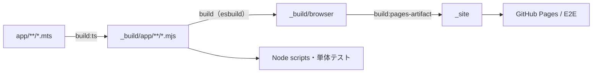

# 開発ガイド

鐘輝かう 歌サーチを開発するための手順です。
利用者向けの説明は [README.md](../README.md)、設計の詳細は [DESIGN.md](DESIGN.md) を参照してください。

## 目次

- [環境準備](#環境準備)
- [ローカルで動かす](#ローカルで動かす)
- [よく使うコマンド](#よく使うコマンド)
- [ディレクトリ構成とビルドの流れ](#ディレクトリ構成とビルドの流れ)
- [型検査とlint](#型検査とlint)
- [テスト](#テスト)
- [ブランド画像の生成](#ブランド画像の生成)
- [CI・デプロイ](#ciデプロイ)
- [関連ドキュメント](#関連ドキュメント)

---

## 環境準備

- Node.js は CI と同じ 24.22.1 を使用してください。
- 初回または `node_modules` がない環境では、検証コマンドの前に `npm install` を実行してください。
  - `npm run lint` は devDependencies の ESLint を使う前提です。`node_modules` がないと、
    環境側の古い ESLint が実行されることがあります。
- E2E テスト（Playwright）を初回実行する前に、次を準備してください。
  - `npx playwright install chromium webkit`
  - Linux では、WebKit が使うライブラリを `sudo npx playwright install-deps webkit` で入れること
  - `python3` が PATH 上で利用できること
- Playwright は 1.63.0 に固定しています。
  - 1.60.0 より前は、Node 24.16 でブラウザのインストールが展開の途中で止まります。
  - 1.64 に同梱の WebKit は、`<select>` があるだけで CSP（`style-src-attr`）の違反を記録し、
    CSP の E2E が WebKit で落ちます。1.64 以降へ上げるときは、この対応も行ってください。

## ローカルで動かす

`app/**/*.mts` は TypeScript source なので、ブラウザで確認するには build が必要です。

```sh
npm run build
python3 -m http.server 8000 --directory _build
```

fresh checkout 後や `.mts` を変更した後は、毎回 `npm run build` を実行してください。
`npm run build:ts` 単体ではブラウザ用 bundle を更新しません。

## よく使うコマンド

通常は「コマンド」列を使います。「事前build」はコマンド内で自動実行される処理です。
build 済みの生成物を再利用したい場合は、対象ソースの変更を反映した build が完了していることを確認してから「再利用用コマンド」を使ってください。

| コマンド | 用途 | 事前build | 再利用用コマンド |
| --- | --- | --- | --- |
| `npm run build:ts` | TypeScript を `_build/app` へ emit | なし | なし |
| `npm run build` | ブラウザ用の静的サイトを `_build` へ作成 | TypeScript emit | なし |
| `npm run build:pages-artifact` | 配布用の `_site` を作成 | `build` | なし |
| `npm run build:songs-json` | CSV から曲JSONを生成 | `build:ts` | `npm run build:songs-json:raw` |
| `npm run validate:songs-json` | 曲JSONを検証 | `build:ts` | `npm run validate:songs-json:raw` |
| `npm run typecheck` | 全領域の型検査 | なし | `npm run typecheck:raw`（同じ型検査） |
| `npm run check:ts-emit` | emit 結果の存在と source tree の確認 | TypeScript emit | `npm run check:ts-emit:raw` |
| `npm run lint` | ESLint | なし | `npm run lint:raw` |
| `npm run test:unit` | Node 単体テスト | `build:ts` | `npm run test:unit:raw` |
| `npm run test:e2e` | Playwright E2E | `build:pages-artifact`（内部で `build`） | なし |

変更内容ごとの確認手順は [AGENTS.md の Verification](../AGENTS.md#verification) にまとめています。

## ディレクトリ構成とビルドの流れ

| パス | 内容 |
| --- | --- |
| `public/` | `index.html`・`styles.css`・アイコン・OGP 画像。build で site のルートへコピーする |
| `app/` | アプリの TypeScript source（`.mts`）。`.mjs` は置かない |
| `scripts/` | build・曲JSON生成・配布確認などの Node scripts（`.mts` を Node で直接実行） |
| `tests/` | Node 単体テスト。`tests/e2e/` は Playwright E2E |
| `types/` | 複数 module で共有するドメイン型の ambient 宣言 |
| `data/` | CSV から生成した `songs.json` / `songs-meta.json` |
| `design/brand/` | OGP 画像・アイコンの描画元 HTML |
| `docs/` | 開発ガイド・設計書・作業の進め方 |
| `_build/` | build 生成物（Git 管理外） |
| `_site/` | Pages 配布用 artifact（Git 管理外） |



- `_build/app` は Node scripts とテスト用です。配布物には含めません。
- `npm run build` は `public/` の静的 asset と bundle を `_build` へ作り、`.ts` / `.mts` source は含めません。
  ブラウザ用 bundle は起動処理・UI・共有処理に分割し、`modulepreload` を HTML に生成します。
- CSS / JavaScript の URL は build 時に内容ハッシュで決まります。曲JSONだけの変更では URL は変わりません。
  明示的にバージョンを変える場合は `DEPLOY_CACHE_BUSTER` 環境変数か `npm run build -- --cache-buster <version>` を使います。
- `npm run check:ts-emit` は、`_build/app` に生成 `.mjs` があり、`app` に `.mjs` が残っていないことを確認します。
- `scripts/**/*.mts` は Node 標準の型除去機能で直接実行します（例: `node scripts/build-ts.mts`）。
  事前コンパイルや `tsx` は不要ですが、実行時には型検査されないため `npm run typecheck` を別途実行してください。
- 曲JSONの生成・検証 scripts は `#app/*` でアプリ module を読みます。`package.json` の `imports` により、
  型検査時は `app/*.mts`、実行時は `_build/app/*.mjs` へ解決されます。

## 型検査とlint

`npm run typecheck` は次の4領域をまとめて実行します。いずれも事前 build は不要で、生成物を更新しません。

| コマンド | 対象 | 設定 |
| --- | --- | --- |
| `npm run typecheck:app:raw` | アプリ | `tsconfig.json` |
| `npm run typecheck:scripts:raw` | Node scripts | `scripts/tsconfig.json` |
| `npm run typecheck:tests:raw` | Node 単体テストと共通helper | `tests/tsconfig.json` |
| `npm run typecheck:e2e:raw` | E2E と共通helper | `tests/e2e/tsconfig.json` |

- すべて `strict: true` です。scripts は Node が型を除去して実行できる構文に限定するため、
  `erasableSyntaxOnly`・`verbatimModuleSyntax` も有効にしています。
- ESLint は `app/`・`scripts/`・`tests/` の `.mts` に直接適用し、`_build` は対象外です。

## テスト

| 種類 | 場所 | 実行方法 | 検証すること |
| --- | --- | --- | --- |
| 単体テスト | `tests/*.test.mts` | `tsx` 経由で `app/**/*.mts` を直接 import | ロジック、controller、DOM モックでの状態遷移 |
| scripts のテスト | `tests/*.test.mts`（一部） | scripts 経由で `_build/app` を読む | 曲JSON・build・配布成果物の整合性 |
| E2E | `tests/e2e/*.spec.mts` | Playwright（Chromium・WebKit）で `_site` を検証 | 起動順序、保存状態、レイアウト、キーボード操作、再生 |

- `npm run test:unit` は、scripts のテストが生成 module を読むため事前に `build:ts` を実行します。
  `tsx` は型検査をしないため、`npm run typecheck` も併せて実行してください。
- テストファイル名は対象 module に揃えています（例: `app/lib/search-query.mts` → `tests/search-query.test.mts`）。
  一覧は `ls tests/` で確認してください。
- E2E では `_site` を `python3 -m http.server 4173` でローカル配信し、曲データと YouTube Iframe API はモックに差し替えます。
- E2E は Chromium と WebKit で実行します。WebKit は Safari と同じエンジンですが、iOS の判定（`isIOSWebKit`）は真にならず、
  長押しの操作も再現できません。iOS Safari は実機または手動で確認してください。
- WebKit では、Playwright の screenshot のたびに CSP の違反（`style-src-elem`）が 1 件記録されます。
  Playwright が撮影時に style を差し込むためです。CSP の違反が 0 件であることを確かめるテストでは、確かめる前に撮影しないでください。

### 共通helper

| 用途 | 場所 |
| --- | --- |
| DOM・YouTube のハーネス | `tests/test-helpers.mts`、`tests/youtube-harness.mts` |
| 曲データ・検索・保存・YouTube の fixture | `tests/fixtures/` |
| 再生設定・並び替えの fixture | `tests/support/` |
| E2E の通信モック | `tests/e2e/support/network-mocks.mts`（`songs-network.mts` と `mock-youtube.mts` を組み合わせる） |
| E2E のキャッシュ操作・観測 | `tests/e2e/support/songs-cache.mts` |
| E2E の画面操作・曲生成 | `tests/e2e/support/ui-helpers.mts`、`tests/e2e/support/song-fixtures.mts` |
| ブラウザ内 YouTube モック | `tests/e2e/support/youtube-iframe-api.mts`（API 要求時に esbuild で JS へ変換して配信） |

テスト専用の Window 拡張は `tests/e2e/browser.types.d.ts` に限定しています。

## ブランド画像の生成

`public/` の `ogp.png`・`apple-touch-icon.png`・`favicon-32.png` は、`design/brand/` の描画元と `public/favicon.svg` から生成します。

```sh
npm run render:brand-assets
```

- 描画には Playwright の Chromium と OS の日本語フォント（Noto Sans CJK JP）を使います。
  フォントが異なる環境では文字の見た目が変わります。
- `public/favicon.svg` は直接編集します。

## CI・デプロイ

| Workflow | 役割 |
| --- | --- |
| `update-songs-json.yml` | 1日2回 CSV から曲JSONを生成・検証し、差分があれば `main` へコミット |
| `ci.yml` | `main` への push / PR で build・検証・型検査・lint・単体テスト |
| `e2e.yml` | `main` への push / PR で Chromium と WebKit の E2E。deploy の条件には含めず、`main` へのマージの条件にする |
| `deploy-pages.yml` | `main` の CI 成功後に GitHub Pages へ deploy し、公開を確認。失敗時は Issue で通知 |

`main` へのマージには、CI の `test` と E2E の `e2e` の成功を必須にしています（`.github/rulesets/main.json`）。
ruleset はリポジトリの設定なので、ファイルを変えても自動では反映されません。次の手順で取り込みます。

1. Settings → Rules → Rulesets → New ruleset → Import a ruleset で、`.github/rulesets/main.json` を選ぶ
2. Bypass list に、曲データ更新の GitHub App（`knksongs-song-data-updater`）が Always allow で入っていることを確かめる。
   App は `main` へ直接 push するので、入っていないと自動更新の push が拒否される
3. Create で保存する

画面で ruleset を変えたときは、Export した JSON で `.github/rulesets/main.json` を置き換えてください。

権限設計、`main` との照合、失敗通知の詳細は [DESIGN.md の CI・デプロイ](DESIGN.md#ciデプロイ) を参照してください。

## 関連ドキュメント

- [DESIGN.md](DESIGN.md): 設計書（データフロー、検索ロジック、永続化、CI・デプロイ）
- [WORKFLOW.md](WORKFLOW.md): 作業の進め方
- [AGENTS.md](../AGENTS.md): コーディング規約、コミット形式、検証手順
